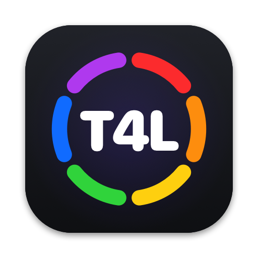
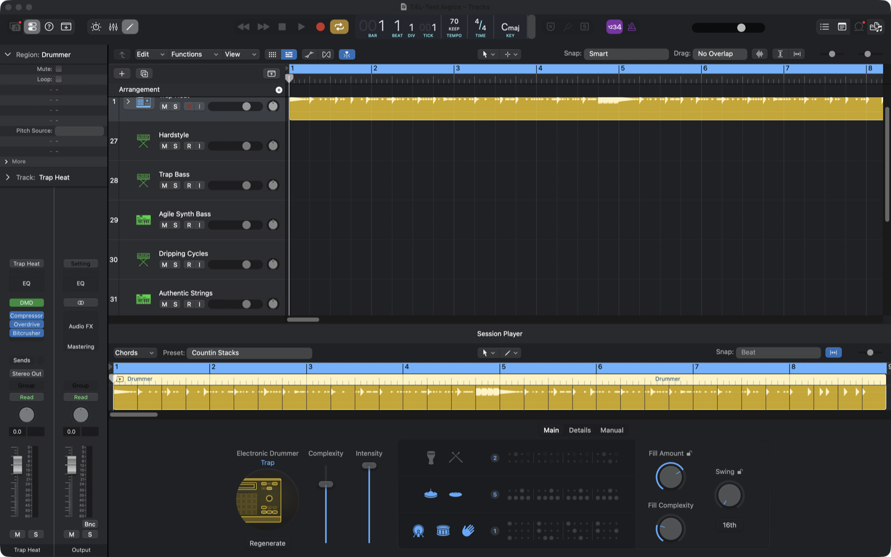
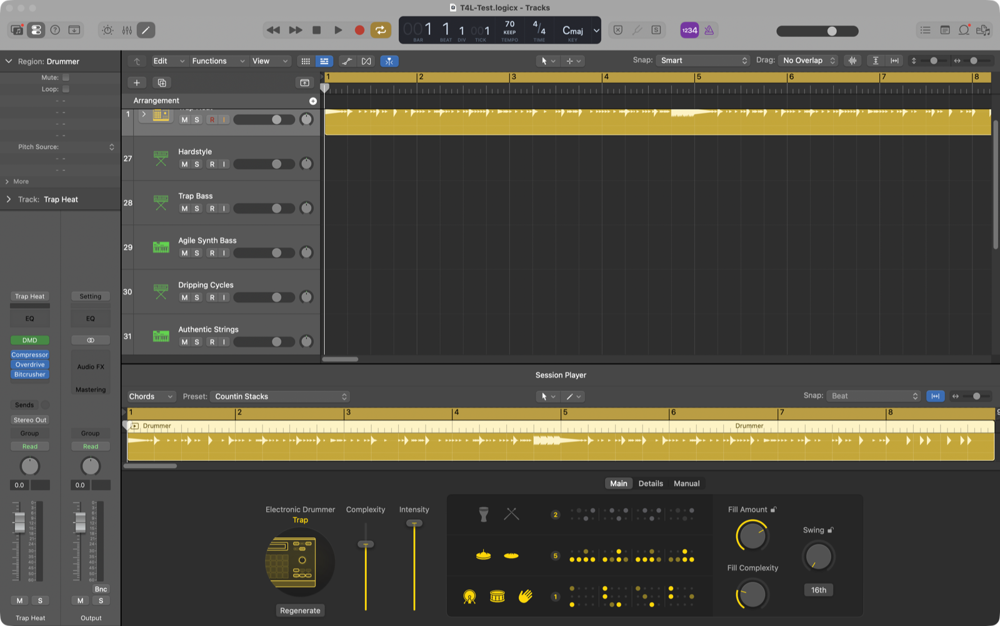
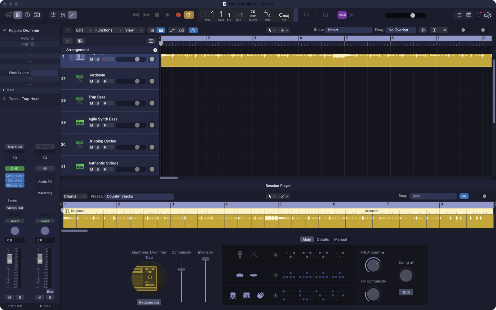
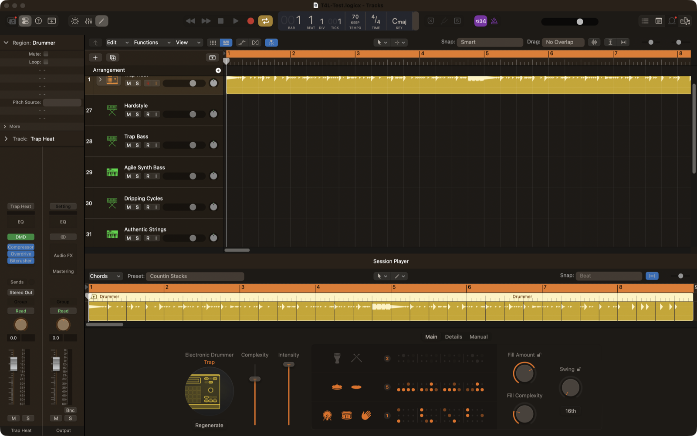
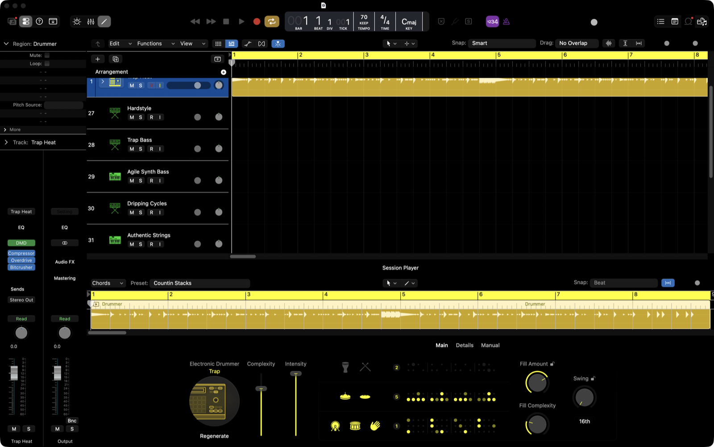

<p align="center">
  
</p>

<h1 align="center">Theme4Logic</h1>

<p align="center"><b>Free, open-source color themes for Logic Pro.</b><br>
13 presets, a color editor, and nothing on disk is ever modified.</p>

<p align="center"><b>Beta.</b> There is no download: you get it from this repository and build it on your Mac with one command.</p>

<p align="center">
  
</p>

| Stock Logic Pro | Midnight | FL Studio-inspired | Dawnamite High Contrast |
|---|---|---|---|
|  |  |  |  |

## What it does

Theme4Logic launches Logic Pro with a small theme engine (`colorize.dylib`) loaded into it. The engine swaps Logic's interface colors as they are drawn:

- the arrange window, track headers, inspector, rulers, Library, and editors
- the mixer and channel strips
- the transport display
- SwiftUI panels such as Session Player, through Logic's own asset catalogs

Logic is **never edited on disk** and is **never re-signed**. Quit Logic, open it normally, and it's stock again.

## Requirements

- **Logic Pro 12.3 or 12.4** from the Mac App Store, installed at `/Applications/Logic Pro.app`
- Xcode Command Line Tools (`xcode-select --install`) to build the app
- Apple Silicon or Intel Mac

The engine only installs its hooks on Logic versions it has been checked against (see [`poc/hook-manifests/`](poc/hook-manifests)). On any other version it does nothing and Logic opens with its normal colors. Nothing breaks, and the app tells you the version isn't supported yet.

## Install

There is no prebuilt download. You build the app from this source on your own Mac:

```bash
git clone https://github.com/iacompa/Theme4Logic.git
cd Theme4Logic
./open_app.sh
```

`open_app.sh` builds `Theme4Logic.app` and opens it. A copy is kept at `~/Library/Application Support/Theme4Logic/build/Theme4Logic.app`, and you can drag it to your Dock.

> **Not signed or notarized by Apple.** We recommend reading the source here and building it straight from this repository. Your Mac ad-hoc signs the app when you build it, and because you compiled it locally, macOS runs it like any app you build yourself. Every line that runs is in this repository.

## Use

1. Open **Theme4Logic** and pick a preset. You can tweak the key colors in the editor if you like.
2. Optionally click **Open project…** to have Logic open a specific project.
3. Click **Apply & Launch Logic Pro**. If Logic is open, it will ask Logic to quit first. Save your work.
4. Logic opens with the theme. To switch themes, pick another one and launch again.

To go back to stock, click **Launch Logic without theme**, or quit Logic and open it normally from the Dock or Finder.

## Presets

| Preset | Look |
|---|---|
| **Midnight** | Deep navy, the original Theme4Logic look |
| **Ableton Classic** | Neutral charcoal with warm orange accents |
| **Ableton Dark** | Graphite with cyan transport |
| **Angst Robot** | Deep purple with neon highlights |
| **FL Studio Fruity** | Warm brown and orange |
| **Pro Tools** | Charcoal with a green LCD transport |
| **Studio One** | Cool grey and blue |
| **Reaper** | Flat grey with teal |
| **Voice Memos** | OLED black with red accents |
| **Dawnamite Dark** | Cool graphite with a sky-blue accent |
| **Dawnamite Light** | Soft grey daylight theme (experimental) |
| **Dawnamite High Contrast** | Pure black, white text, yellow focus |
| **Dawnamite Safe** | Near-black accessible theme with yellow focus |

Preset names describe a color mood only. Theme4Logic is not affiliated with Apple or with any DAW maker named above, and their trademarks belong to their owners.

## What is and isn't themed

Theme4Logic aims to restyle the whole interface, but some colors are left alone on purpose and some are still out of reach. The honest picture:

| Area | Status |
|---|---|
| Arrange, track headers, inspector, rulers, Library, editors | Themed |
| Mixer and channel strips | Themed |
| Transport display | Themed |
| Session Player and other SwiftUI panels | Themed (accent and neutrals) |
| Record, mute, solo, meters, track and region colors | **Kept on purpose**: they carry meaning |
| A few hard-coded controls (cycle button, plugin-slot blue, MIDI icons, the mixer's empty "Group" slot label) | Not yet themed |
| Third-party plugin windows | Not themed: they draw their own UI |
| **Dawnamite Light** | **Experimental**: text is readable, but a few pane dividers and plug-in slots keep Logic's dark colors |

For colors no preset names explicitly, a fallback maps Logic's stock greys onto each theme's lightness ramp and moves Logic's blue and yellow accents to the theme accent. New Logic screens therefore pick up the theme instead of staying stock grey.

## Safety

- Logic's app bundle and code signature are never modified.
- The engine refuses to hook an unknown Logic version or build. It fails safe and Logic opens stock.
- It writes a status file, `~/Library/Application Support/Theme4Logic/colorize-status.json`, so the app can confirm the theme actually loaded.
- **Uninstall:** delete `Theme4Logic.app` and `~/Library/Application Support/Theme4Logic`.

Injection works because the Mac App Store build of Logic allows `DYLD_INSERT_LIBRARIES`. If a future Logic update blocks it, Theme4Logic will stop theming, and Logic itself keeps working.

## Make your own theme

A theme is a small palette file in [`themes/palettes/`](themes/palettes). It lists a background, panel, and accent, plus optional overrides. The generator expands it into the 230+ colors Logic uses:

```bash
cp themes/palettes/dawnamite-dark.json themes/palettes/my-theme.json
# edit colors, then add an entry for it in themes/preset-manifest.json
python3 tools/generate_all_presets.py
./tools/launch_preset.sh my-theme      # launch Logic with it, no GUI needed
```

Pull requests with new presets are welcome.

## Supporting a new Logic version

When Logic updates, the engine stays off until someone checks the new build:

1. Copy the newest file in `poc/hook-manifests/` to `logic-<version>-hooks.json`, and set `logicVersion` and `logicBuild` to match the new Logic.
2. Launch a preset with `./tools/launch_preset.sh midnight` and check the arrange window, mixer, Library, editors, and Session Player.
3. Run the checks below and open a pull request.

## Developers

Architecture: [`docs/ARCHITECTURE.md`](docs/ARCHITECTURE.md). Engine internals: [`poc/README.md`](poc/README.md).

```bash
PYTHONDONTWRITEBYTECODE=1 python3 -m unittest discover -s tests -q
python3 tools/audit_presets.py
python3 tools/validate_visual_baselines.py --allow-missing
for s in tests/scripts/*.sh; do "$s"; done
./app/build_app.sh && codesign --verify --deep --strict app/build/Theme4Logic.app
```

To log every color name Logic asks for (useful for expanding coverage), launch with `THEME4LOGIC_DEBUG=1`. The names are written to `seen-*.txt` in `~/Library/Application Support/Theme4Logic/`.

## License

[MIT](LICENSE) © 2026 IA COMPA LLC. Logic Pro is a trademark of Apple Inc. This project is not affiliated with or endorsed by Apple.
